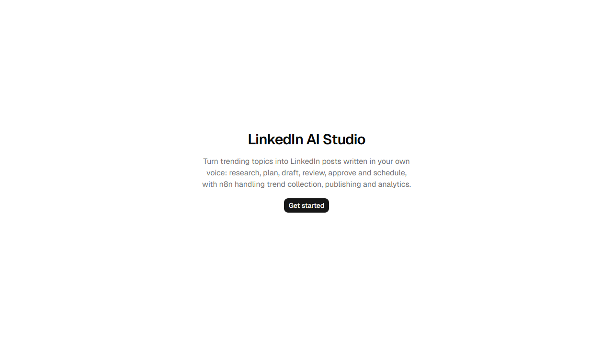
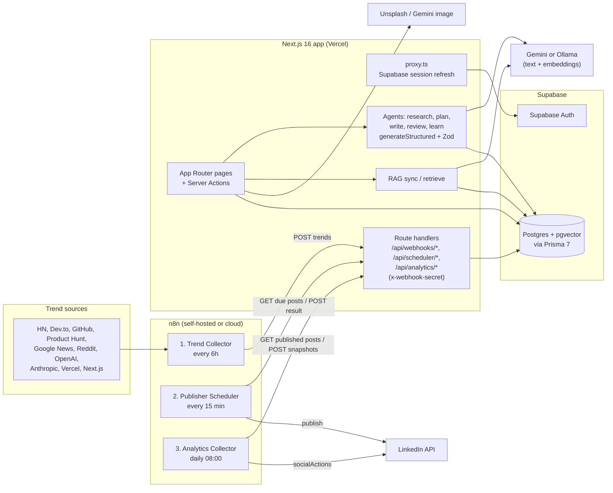
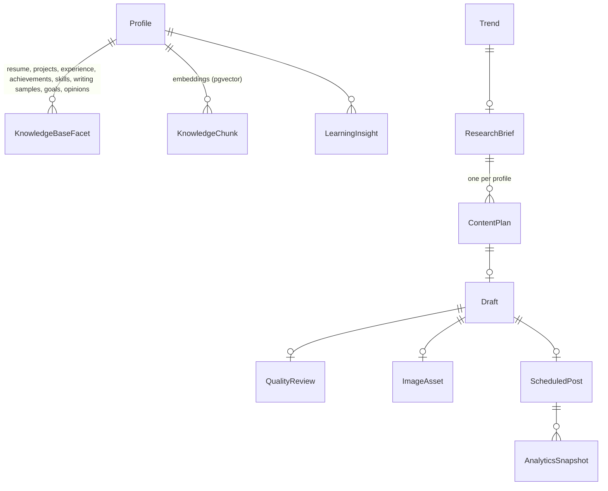

# LinkedIn AI Studio

A personal content pipeline that turns trending tech topics into LinkedIn posts written in your own voice: n8n collects trends, a chain of LLM agents researches, plans, drafts and critiques each post using a RAG-backed personal knowledge base, and you approve and schedule. n8n then publishes to LinkedIn and pulls engagement back in.

[](https://github.com/Sami123d/linkedin-ai-studio/actions/workflows/ci.yml)


**Live deployment:** https://linkedin-ai-studio-alpha.vercel.app shows the landing, login and register pages. Every app page is behind Supabase Auth, and the pipeline only does something once the AI keys, Knowledge Base and n8n workflows are set up (see [Getting started](#getting-started)).



## Status

The whole pipeline is written: milestones 0 to 15 plus the three n8n workflows are in the git history. It is a single-developer project and has **not** been proven end-to-end against LinkedIn:

| Area | State |
|---|---|
| Auth, Knowledge Base, RAG, all agents, approval/calendar UI, webhook API | Implemented |
| n8n Trend Collector | Implemented; the workflow doc says its sources were checked against their live endpoints |
| n8n Publisher Scheduler | Implemented with n8n's LinkedIn node. Not verified against a real LinkedIn app. Carousels are published as a numbered text post |
| n8n Analytics Collector | Implemented. Likes and comments only: LinkedIn's standard API does not expose impressions or shares, so engagement rate stays empty |
| Gemini image generation | Scaffold only (needs a billed Gemini account). Unsplash search is the default image source |
| Automated tests | Unit tests for validation, webhook auth, structured LLM output and the trends webhook. No DB or end-to-end tests yet |

## Features

- **Auth**: Supabase email/password sign-up and login. Session cookies are refreshed in `proxy.ts`, and the `(app)` layout redirects signed-out users to `/login`.
- **Knowledge Base** (`/knowledge-base`): CRUD for resume, projects, experience, achievements, skills, writing samples, goals and opinions, all scoped to the signed-in profile.
- **RAG sync**: embeds Knowledge Base entries into a `knowledge_chunks` table (pgvector, 768 dimensions) and retrieves them by cosine similarity for the planning and writing agents.
- **Trends** (`/trends`): trends arrive from n8n through a webhook protected by a shared secret. You mark them reviewed or dismissed.
- **Agent pipeline**, one page per stage. Every run is stored with status, provider/model and an attempt log (prompt, raw response, error):
  1. **Research**: a brief with summary, insights, opportunities, risks and content angles.
  2. **Planning**: picks a format (single post, carousel or article), an angle and key message, using the goals and RAG context.
  3. **Writing**: drafts the post and hashtags from your writing samples and RAG context.
  4. **Quality review**: scores hook, clarity, voice match, value and CTA (0 to 100) and gives a verdict and feedback. The overall score is computed in code.
  5. **Images**: Unsplash search for the draft, or Gemini image generation.
- **Approval and calendar** (`/approval`, `/calendar`): approve a draft with a publish time, then see it on a month calendar with its published or failed state.
- **Research Studio** (`/studio`): research a topic or prompt from real, dated sources (Hacker News Search, DEV, optional Brave News, collected trends), review an evidence-backed brief, then create LinkedIn, Facebook and Instagram posts through the existing pipeline. Needs the `20261019000000_add_research_studio` migration. See "Research Studio" below.
- **Platforms** (`/platforms`): adapt a completed LinkedIn draft into Facebook Page and Instagram versions, then preview, edit, approve or reject each. Connect a Meta account and publish approved variants through the official Graph API (Facebook Page text/link/image posts, Instagram single-image posts). A post is **Published** only after Meta confirms it. Needs the `20261018000000_add_platform_variants`, `20261018010000_add_meta_publishing` and `20261018020000_publish_media_select_policy` migrations and Meta app setup (see Meta publishing).
- **Analytics and learning** (`/analytics`, `/learning`): engagement snapshots per post, and an LLM "learning insight" that summarises what worked across your measured posts. It is shown to you and is not fed back into the agents automatically.
- **Pluggable providers**: `AI_PROVIDER=gemini|ollama` switches text generation and embeddings, and `IMAGE_PROVIDER=unsplash|gemini` switches images. Agents only depend on the `AIProvider` interface, and all JSON output goes through one Zod-validated `generateStructured()` helper.

## Architecture



### Auth and request flow

- **`proxy.ts`** (Next.js 16's replacement for `middleware.ts`) runs `updateSession()` from `src/lib/supabase/proxy.ts` on every non-static request. It refreshes the Supabase session cookie, copies Supabase's cache headers onto the response so a CDN can't serve one user's cookie to another, redirects signed-out users away from `/dashboard` and `/profile`, and sends signed-in users from `/login` and `/register` to `/dashboard`.
- **`src/app/(app)/layout.tsx`** checks `getClaims()` and redirects to `/login` for every page in the app, so pages outside the proxy's list are protected too.
- **Server actions** call `requireProfileId()` and scope every Prisma query by the user's id. Prisma connects as a privileged role that bypasses RLS, so this check in the app is the real authorization boundary. RLS is enabled with no policies as defense in depth.
- **n8n endpoints** have no session. Each checks its own shared secret (`TREND_`, `SCHEDULER_`, `ANALYTICS_WEBHOOK_SECRET`) with a constant-time comparison (`src/lib/webhook-auth.ts`).
- `GET /api/scheduler/due` claims posts with a single `UPDATE ... FOR UPDATE SKIP LOCKED`, so overlapping n8n runs can't publish the same post twice. A claim that is never confirmed becomes claimable again after 15 minutes.

### Data model (Prisma, `prisma/schema.prisma`)



- `Profile.id` equals the Supabase `auth.users` id. It is inserted by a Postgres trigger defined in the first migration, never by app code.
- Each AI stage (research, plan, draft, review, image, learning) has a status enum and a `*Attempt` audit table.
- `Trend` and `ResearchBrief` are shared. Everything from `ContentPlan` onward belongs to a profile.
- Engagement rate is derived from the stored counts (`computeEngagementRate`) and never stored.
- Raw SQL migrations in `prisma/migrations/` add the pgvector extension and index, the resume storage bucket, the signup trigger and RLS.

### n8n workflows (`n8n/workflows/`)

Every workflow reads `APP_BASE_URL` from the n8n environment and sends its secret through an n8n Header Auth credential, so the exported JSON contains no secrets. Each workflow has a detailed `.md` next to its `.json`.

| Workflow | Trigger | What it does | Key nodes |
|---|---|---|---|
| **01 Trend Collector** (34 nodes) | Cron `0 */6 * * *` | Pulls from 10 sources in parallel branches, normalizes them to one shape, merges, deduplicates, scores, puts each item in one of 6 categories, drops items older than 14 days, keeps the top 30 and POSTs them to `/api/webhooks/trends` | HTTP Request (HN Algolia, Dev.to, GitHub search, Product Hunt GraphQL, Reddit RSS), RSS Feed Read (Google News, OpenAI, Anthropic via Google News, Vercel, Next.js), Code (normalize, dedupe, score, categorize, rank), Merge, IF |
| **02 Publisher Scheduler** (9 nodes) | Cron `*/15 * * * *` | `GET /api/scheduler/due` claims the approved posts that are due. For each one it builds the post text (carousel slides are joined into a numbered list), publishes with or without an image, and POSTs success or failure to `/api/scheduler/publish` | HTTP Request, Code, IF (has image?), LinkedIn node (OAuth2) |
| **03 Analytics Collector** (10 nodes) | Cron `0 8 * * *` | `GET /api/analytics/published-posts`, gets the LinkedIn post URN, calls `GET /v2/socialActions/{urn}` for likes and comments, and POSTs the batch to `/api/webhooks/analytics`. Failed lookups are left out rather than sent as zeros | HTTP Request (LinkedIn OAuth2), Code, IF |

Fetch and POST nodes use `retryOnFail` (3 tries, 5 s apart). A failing source or post doesn't stop the rest of the run.

### Free hosting without n8n: GitHub Actions trend collector

`scripts/collect-trends.ts` is a dependency-free port of the Trend Collector: same 10 sources, scoring, categories, 14-day filter and top-30 cap. `.github/workflows/trend-collector.yml` runs it every 6 hours on GitHub Actions, so the deployed app gets trends with no n8n server to host. The regular trend inserts should also help keep a free Supabase project active, since Supabase pauses free projects after a week without database activity.

Setup, in the repository's **Settings → Secrets and variables → Actions**:

- Secret `TREND_WEBHOOK_SECRET`: the same value as in Vercel.
- Variable `APP_BASE_URL`: the deployed app URL, e.g. `https://linkedin-ai-studio-alpha.vercel.app`.
- Optional secret `PRODUCT_HUNT_TOKEN` to enable the Product Hunt source.

Then run it once from the **Actions** tab (**Trend Collector → Run workflow**). To try it locally without sending anything: `node --experimental-strip-types scripts/collect-trends.ts --dry-run` (Node 22). GitHub turns off scheduled workflows after 60 days without commits to the repo; re-enable it from the Actions tab if that happens.

The other two workflows have GitHub Actions ports as well, so n8n is optional end to end:

| Workflow file | Script | Schedule | Secrets |
|---|---|---|---|
| `linkedin-publisher.yml` | `scripts/linkedin-publisher.ts` | every 15 min | `SCHEDULER_WEBHOOK_SECRET`, `LINKEDIN_ACCESS_TOKEN`, optional `LINKEDIN_PERSON_URN` |
| `meta-publisher.yml` | `scripts/meta-publisher.ts` | every 15 min | `META_PUBLISH_WEBHOOK_SECRET` (triggers in-app Facebook/Instagram publishing, see below) |
| `linkedin-analytics.yml` | `scripts/linkedin-analytics.ts` | daily 08:00 UTC | `ANALYTICS_WEBHOOK_SECRET`, `LINKEDIN_ACCESS_TOKEN` |

The publisher posts through LinkedIn's `ugcPosts` API (uploading the image first when the draft has one), checks the token before it claims any due posts, and reports each result to `/api/scheduler/publish`. Create `LINKEDIN_ACCESS_TOKEN` with LinkedIn's [OAuth token generator](https://www.linkedin.com/developers/tools/oauth/token-generator) for your app, with the `openid`, `profile` and `w_member_social` scopes. These tokens expire after about 60 days; a failed (red) publisher run with a 401 means it is time to generate a new one and update the secret.

### Research Studio (trend-to-post with real sources)

`/studio` turns a topic or a natural-language request ("Find recent trends about AI agents in e-commerce, prioritize the last seven days, and create an educational post for business owners") into a sourced research brief and then into LinkedIn, Facebook and Instagram posts through the existing pipeline. You can also start from a collected trend (the telescope button on `/trends`).

**How sources are found.** The model only writes search *queries*; it never produces results. Queries go to official, documented APIs:

- **Hacker News Search** (Algolia, `hn.algolia.com/api/v1/search`, no key).
- **DEV** (Forem API v1, `GET /api/articles/search?q=`, no key).
- **Brave Search News API** (optional, `BRAVE_SEARCH_API_KEY`; broad news coverage, paid plan with monthly free credits).
- Trends the scheduled collector already stored (their own source URL and date).

Google News RSS is **not** used for on-demand search: `news.google.com/robots.txt` disallows automated access. (The scheduled collector and the n8n Trend Collector still fetch Google News RSS; review that separately.) Every result is validated (title and http(s) URL required, invalid or far-future dates dropped, markup stripped), deduplicated (canonical URL ignoring `www`, tracking parameters and fragments, or the same normalized title) and labelled **recent** (inside your timeframe), **background** (older) or **undated**. The search window goes back further than the timeframe so older background material is available but clearly separated. One provider failing never fails the others; if every provider fails, the request is marked failed and can be retried. Each discovery run is audited (queries, per-provider result counts and errors, the query-extraction prompt/response).

**Research brief.** You choose which sources to use (the five most recent are pre-selected) and optionally a focus headline. The brief is written only from those sources: each finding must cite source ids, citations are checked against the real list, findings without a valid citation are shown as **Unverified** (never as key insights), and made-up source ids are removed and reported. The brief shows a summary, why it matters now, findings with expandable evidence (title, publisher, date, link), counterpoints and limitations, angles, and audience/platform fit. The cited sources are stored as a snapshot with the brief, so provenance survives a later re-search.

**Content.** "Continue to content" runs the existing plan → write → review → image steps and then creates the Facebook/Instagram variants you selected. Your audience, tone, angle, purpose, call to action, extra instructions and the source-backed findings are passed into planning, writing and the variants. Posts contain no URLs unless you turned "Source links in posts" on (then only cited source URLs are offered). Everything is then edited, approved, scheduled and published in the existing Approval and Platforms screens; Research Studio never approves or publishes. Campaign cards on `/platforms` link back to the research.

**Privacy.** Requests, sources and discovery logs are profile-owned. A brief is stored on a *private* `Trend` (`profileId` set) so the pipeline can run unchanged; the shared Trends, Research and Planning views and the pipeline/research/planning actions exclude other profiles' private trends, and trend housekeeping never deletes private ones.

### Meta publishing (Facebook Pages and Instagram)

`/platforms` can publish approved variants to a **Facebook Page** and a linked **Instagram professional account** through Meta's official Graph API (pinned to `v25.0`, override with `META_GRAPH_API_VERSION`). **Version decision:** Meta's changelog lists `v26.0` (released 2026-07-29, expiry TBD) as the latest, but its current Pages and Instagram publishing guides still use `v25.0` (supported until 2028-07-29). The v26.0 changelog contains no change to any endpoint this app calls (`oauth/access_token`, `me`, `me/permissions`, `me/accounts`, Page `feed`/`photos`/`posts`, Instagram `media`/`media_publish`/container status), so there is no benefit to moving yet. Upgrade by setting `META_GRAPH_API_VERSION=v26.0` after a successful live test on `v25.0`. LinkedIn publishing is unchanged and still runs through the external publisher.

**What it supports:** Facebook Page feed posts (text, a link, or one image; never personal profiles) and Instagram single-image feed posts. No Stories, Reels, carousels or WhatsApp.

**How it works**

1. **Connect** (`Connect Meta account` on `/platforms`): Meta's OAuth dialog, a CSRF-checked callback at `/auth/meta/callback`, a short-lived to long-lived (~60 days) user token exchange, then you pick a Page. The Page's access token (it does not expire, but Meta invalidates it on password change, role removal or app removal) and the Instagram account linked to that Page are stored. All tokens are AES-256-GCM encrypted with `TOKEN_ENCRYPTION_KEY` and never sent to the browser. There is no refresh endpoint: when the user token expires you reconnect.
2. **Approve** a variant with a date. For images, the campaign image is downloaded, converted to a JPEG that meets Instagram's rules (8 MB, 4:5 to 1.91:1, max 1440 px wide; the branded 1200x627 image is trimmed by a few pixels) and stored in the public `publish-media` Supabase bucket, so Meta can fetch a stable HTTPS URL. Conversion uses `sharp` (a declared dependency); if its native binary fails to load on the host, approval fails with a clear message instead of publishing a bad image. **Only these prepared JPEGs are public**, under `<profileId>/<random-uuid>.jpg` (the bucket only accepts `image/jpeg` up to 8 MB; resumes and every other bucket stay private). Uploads happen at approval time with the signed-in user's session, restricted by storage policy to their own folder. **Image download protection:** the server downloads campaign images only from an allowlist of provider hosts (`images.unsplash.com`, `plus.unsplash.com`, `gen.pollinations.ai`, `image.pollinations.ai`, `media.pollinations.ai`; see `PUBLISH_IMAGE_HOSTS` in `src/features/platforms/media-path.ts`), over HTTPS on port 443, without credentials or IP-literal hosts. Each connection is DNS-pinned (`src/lib/net/pinned-fetch.ts`): the name is resolved once, the connection is refused if any answer is a loopback, private, link-local, CGNAT, reserved, documentation, multicast or otherwise non-global address (IPv4, IPv6, IPv4-mapped, NAT64 and 6to4 forms included), and the socket connects to exactly the address that was checked, with normal TLS certificate verification against the hostname. Redirects are never followed automatically: each hop is re-checked and re-pinned. Bodies are capped at 15 MB and requests time out after 20 s. If a provider starts serving from a new host, add it to the allowlist.

   **Cleanup:** a prepared file is deleted when it is replaced (re-approval, edit, regenerate, options change), when the variant is rejected, and right after a confirmed publish, including scheduled ones. A database reference is cleared only once Storage confirms the file is gone; failures are logged and retried. Files no variant references any more (for example after trend housekeeping deletes a campaign) are removed by an orphan sweep after a 24-hour grace period. All deletes are limited to `<profileId>/<uuid>.jpg` in the profile's own folder. Jobs without a user session (the Meta scheduler, trend housekeeping) need the optional `SUPABASE_SERVICE_ROLE_KEY` for this; without it the same cleanup runs when the owner opens `/platforms`. Trend housekeeping never deletes a campaign whose Facebook/Instagram variant is approved or has any publish activity.
3. **Publish now** on an approved variant, or let the scheduled job do it at the planned time.

**Honest statuses.** A variant is `PUBLISHED` only after Meta returns a post or media id. Otherwise it is *Approved*, *Scheduled*, *Publishing*, *Failed* or *Unconfirmed*. A timeout or an answer without an id after a write is **Unconfirmed**: the post may be live, so it is never retried automatically. Use *Check status* (it looks for a matching post on the platform) before choosing *Publish anyway*. An Instagram container still processing is kept and reused, so a retry never creates a second upload. Claims are one conditional database update, so *Publish now* clicks and scheduler runs cannot publish the same variant twice.

**Scheduled publishing.** `POST /api/scheduler/meta-publish` (header `x-webhook-secret: META_PUBLISH_WEBHOOK_SECRET`, optional body `{"limit": 1-10}`) claims due approved variants with `FOR UPDATE SKIP LOCKED` and publishes them itself, because the tokens never leave the app. `.github/workflows/meta-publisher.yml` (`scripts/meta-publisher.ts`) triggers it every 15 minutes; it only needs `META_PUBLISH_WEBHOOK_SECRET`. If the repository has not set up Meta publishing (no `META_PUBLISH_WEBHOOK_SECRET` secret, or the app answers 503), the job logs a notice and succeeds instead of failing every 15 minutes. A real failure (wrong secret, HTTP error, a failed or unconfirmed publish) makes the run red. A run stops starting new variants after 20 s and polls an Instagram image for at most 10 s, so one run stays within the route's 60 s limit; anything still processing is resumed by the next run. Only never-attempted variants are picked up; Failed and Unconfirmed ones wait for you. The LinkedIn endpoints `/api/scheduler/due` and `/publish` are unchanged.

**Meta app setup (manual)**

1. Create an app at [developers.facebook.com](https://developers.facebook.com/apps) (type *Business*), add the **Facebook Login** product (Facebook Login for Business also works) and copy the App ID and App Secret into `META_APP_ID` / `META_APP_SECRET`.
2. Facebook Login settings → **Valid OAuth Redirect URIs**: add exactly `<NEXT_PUBLIC_SITE_URL>/auth/meta/callback` (for example `https://your-app.vercel.app/auth/meta/callback`; the page shows the exact value). Keep *Client OAuth Login* and *Web OAuth Login* on.
3. Permissions requested (the minimum for the calls the app makes): `pages_show_list` (list Pages), `pages_manage_posts` (post to the Page), `pages_read_engagement` (post permalink, and the status check after an unconfirmed publish; also a documented dependency of the two publishing permissions), `instagram_basic` (Instagram username and permalink, status check; dependency of publishing), `instagram_content_publish` (publish to Instagram). `pages_read_user_engagement` is **not** requested: it is not in Meta's permissions reference. Meta's table lists `pages_read_user_content` as a dependency of `instagram_basic`; it is not requested because no call here needs it, so add it to `META_SCOPES` in `src/lib/meta/oauth.ts` if Meta reports it missing in your testing. In **Development mode** they work without review for people with a role on the app (admin, developer, tester). Posting for anyone else needs **Advanced Access** through App Review and Business Verification. Pages in a Business portfolio may also require `business_management`; Meta's Instagram docs additionally mention `ads_management`/`ads_read` when the user has a Business Manager role on the Page. These are not requested by default. Verify the exact list for your setup in the Graph API Explorer.
4. The Instagram account must be a **professional** (Business or Creator) account, linked to the Facebook Page (Page settings → Linked accounts). Pages that require **Page Publishing Authorization** cannot publish until it is completed.
5. Set the server variables below and redeploy. Generate `TOKEN_ENCRYPTION_KEY` and `META_PUBLISH_WEBHOOK_SECRET` with `node -e "console.log(require('crypto').randomBytes(32).toString('hex'))"`. Changing `TOKEN_ENCRYPTION_KEY` makes stored tokens unreadable: users must reconnect.
6. Apply the migrations (`npx prisma migrate deploy`, see below), then add the GitHub secret `META_PUBLISH_WEBHOOK_SECRET` if you want scheduled publishing.

**Limits and caveats.** Instagram allows about 100 API-published posts per 24 hours per account and Meta's docs name 2,200 characters and 30 hashtags per caption. Meta's rules can change: check the [content publishing guide](https://developers.facebook.com/docs/instagram-platform/content-publishing) and [Pages posts guide](https://developers.facebook.com/docs/pages-api/posts). Disconnecting only removes the stored tokens here; remove the app under Facebook Settings → Business Integrations to revoke it on Meta's side. Deleting the connection leaves approved variants intact but unpublishable until you reconnect.

## Tech stack

- **Framework**: Next.js 16 (App Router, Server Actions, `proxy.ts`), React 19, TypeScript
- **UI**: Tailwind CSS 4, shadcn/ui (Base UI), lucide-react, next-themes (dark mode), react-hook-form
- **Data**: PostgreSQL on Supabase, Prisma 7 with the `@prisma/adapter-pg` driver adapter, pgvector
- **Auth and storage**: Supabase Auth (`@supabase/ssr`), a Supabase Storage bucket for resumes
- **AI**: Google Gemini (`@google/genai`) or Ollama for text and embeddings, Unsplash API for images
- **Validation**: Zod 4 (env, forms, webhook payloads, LLM output)
- **Automation**: n8n
- **Tooling**: ESLint, Prettier, Vitest, GitHub Actions

## Project structure

```
proxy.ts                 Supabase session refresh and route guards
prisma/                  schema.prisma and SQL migrations (pgvector, trigger, RLS)
n8n/                     exported workflows (.json) with design docs (.md)
src/app/(auth)/          login, register
src/app/(app)/           dashboard, knowledge-base, trends, research, planning,
                         writing, review, images, approval, calendar, analytics,
                         learning, profile
src/app/api/             n8n-facing route handlers (secret-protected)
src/ai/                  providers (gemini, ollama, unsplash) and agent prompt/generation code
src/features/            server actions per feature, RAG sync and retrieval
src/validation/          Zod schemas
src/config/              env validation (client and server)
tests/                   Vitest unit tests
```

## Getting started

Requirements: Node 20+, a Supabase project (Postgres with the `vector` extension available), a Gemini API key (or a local Ollama), and an n8n instance if you want the automation. [ONBOARDING.md](ONBOARDING.md) has the full first-time walkthrough, including LinkedIn and n8n credentials.

```bash
git clone https://github.com/Sami123d/linkedin-ai-studio.git
cd linkedin-ai-studio
cp .env.example .env        # fill in the values (DIRECT_URL is needed by the postinstall prisma generate)
npm ci
npx prisma migrate deploy   # applies schema, pgvector, the signup trigger, RLS
npm run dev                 # http://localhost:3000
```

Then register at `/register`, fill in the Knowledge Base, run **RAG Sync**, import the three workflows from `n8n/workflows/` into n8n and set `APP_BASE_URL` there.

## Environment variables

All are validated at startup by Zod in `src/config/env.server.ts` and `src/config/env.client.ts`.

| Variable | Required | Purpose |
|---|---|---|
| `DATABASE_URL` | yes | Pooled Supabase Postgres connection (port 6543) used by Prisma Client at runtime |
| `DIRECT_URL` | yes | Direct connection used by the Prisma CLI (migrate, generate, studio) |
| `NEXT_PUBLIC_SUPABASE_URL` | yes | Supabase project URL |
| `NEXT_PUBLIC_SUPABASE_PUBLISHABLE_KEY` | yes | Supabase publishable (anon) key |
| `NEXT_PUBLIC_SITE_URL` | yes | App origin used in email-confirmation redirect links |
| `TREND_WEBHOOK_SECRET` | yes (16+ chars) | Shared secret for `POST /api/webhooks/trends` |
| `SCHEDULER_WEBHOOK_SECRET` | yes (16+ chars) | Shared secret for `/api/scheduler/due` and `/api/scheduler/publish` |
| `ANALYTICS_WEBHOOK_SECRET` | yes (16+ chars) | Shared secret for `/api/analytics/published-posts` and `/api/webhooks/analytics` |
| `META_APP_ID` / `META_APP_SECRET` | for Meta publishing | Meta app credentials. Server only |
| `TOKEN_ENCRYPTION_KEY` | for Meta publishing | 32 bytes (64 hex chars) encrypting stored Meta tokens and signing the OAuth state |
| `META_PUBLISH_WEBHOOK_SECRET` | for scheduled Meta publishing | Shared secret for `POST /api/scheduler/meta-publish` |
| `META_GRAPH_API_VERSION` | no (`v25.0`) | Graph API version |
| `BRAVE_SEARCH_API_KEY` | no | Brave Search News API key for Research Studio's broad news search. Without it, discovery uses Hacker News Search, DEV and collected trends |
| `SUPABASE_SERVICE_ROLE_KEY` | no | Server only. Lets the scheduler and trend housekeeping delete prepared publish images without a user session. Used only for the `publish-media` bucket (`src/lib/supabase/admin.ts`) |
| `AI_PROVIDER` | no (`gemini`) | `gemini` or `ollama`, used for text generation and embeddings |
| `GEMINI_API_KEY` | for Gemini | Gemini API key |
| `GEMINI_MODEL` | no (`gemini-2.5-flash`) | Text model |
| `GEMINI_EMBEDDING_MODEL` | no (`gemini-embedding-001`) | Embedding model. Must output 768 dimensions to match the `vector(768)` column |
| `OLLAMA_BASE_URL` / `OLLAMA_MODEL` | for Ollama | Local Ollama endpoint and model |
| `IMAGE_PROVIDER` | no (`unsplash`) | `unsplash` (search) or `gemini` (generation, needs billing) |
| `UNSPLASH_ACCESS_KEY` | for Unsplash | Unsplash API access key |

n8n side: `APP_BASE_URL`, plus Header Auth credentials for the three secrets, a LinkedIn OAuth2 credential, and an optional Product Hunt token.

## Testing

```bash
npm run lint
npm run typecheck
npm test          # Vitest
```

The suite in `tests/` covers the Zod schemas for the n8n webhook payloads and LLM review output, the constant-time webhook secret check, the engagement-rate calculation, `generateStructured()` with a fake provider (JSON mode, invalid JSON, wrong shape), and the `POST /api/webhooks/trends` handler with Prisma mocked (401 / 400 / 201 / empty batch). CI (`.github/workflows/ci.yml`) runs lint, typecheck, tests and a production build on every push, using placeholder env values.

## Deployment

- **App**: Vercel. Pushes to `master` deploy to production. Set every variable from the table above in Vercel, and set `NEXT_PUBLIC_SITE_URL` to the production origin.
- **Database**: run `npx prisma migrate deploy` against Supabase whenever new migrations land.
- **n8n**: import the three JSON files, create the credentials, set `APP_BASE_URL` to the deployed URL, and activate the workflows. The checklist is in [ONBOARDING.md, section 7](ONBOARDING.md).

## Roadmap

- [ ] Verify publishing end-to-end against a real LinkedIn developer app (the Publisher Scheduler's LinkedIn node output fields are still unconfirmed)
- [ ] Real multi-image carousels through LinkedIn's Posts API (currently a numbered text post)
- [ ] Impressions and shares (needs LinkedIn Marketing API partner access)
- [ ] Feed learning insights back into the planning and writing prompts
- [ ] Fill the dashboard's "Today's draft" and "Upcoming schedule" cards with real data (they are placeholders)
- [ ] Surface repeated publish failures in the UI (`publish_attempts` is already tracked)
- [ ] Integration tests against a real Postgres with pgvector
